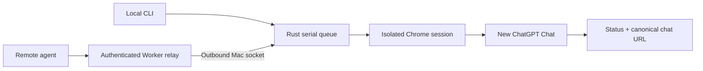

## Input becomes a chat URL

Rust owns validation, MCP semantics, queueing, and durable per-job records. The Cloudflare Worker / Durable Object is transport only. The browser runner selects Chat, applies the requested effort, uploads local images, and sends once. It requires real thinking, working, or streaming evidence and a canonical chat URL; a loading dot or stop button alone is insufficient.

The browser stays warm while queued tasks remain and closes when the queue drains. The remote service keeps a Rust daemon and outbound socket idle, not a Chrome or Node runtime. The optional native app is a CLI wrapper with no WebView and no polling timers. Leave it closed for the lowest idle footprint; quitting it does not stop the service.

## Measure on your machine

No verified RAM, idle CPU, startup latency, throughput, or end-to-end timing numbers are published here. Architecture is an intent, not a benchmark. Account availability, browser startup, image size, network, and queue depth affect results. Measure cold and warm submissions separately and record machine, version, workload, sample count, and observation window before making comparisons.

## State and recovery

The default data root is `~/.config/slingring`, overridden by `SLINGRING_HOME`. It contains private configuration, Unix sockets, the extracted companion extension, and atomic job metadata. Status is read-only and never starts a daemon. Journal records do not contain prompts or image paths. Up to 256 records are retained; request IDs deduplicate within that retention window. A restarted process marks interrupted work failed or uncertain and never replays it.

## Browser boundary

The patched fork owns Chrome launch, the authenticated profile copy, and fingerprint defaults. Slingring does not override them. Limited browser-level CDP installs the companion extension and supplies local files to the file input. It does not turn on Runtime event streaming or scrape answers.

The extension communicates with a short-lived Rust Native Messaging host over a private Unix socket. Native registration is placed in the verified owned browser copy, not another running profile. The extension has no permanent service worker; its controller page exists only during a task. The original browser profile and any normal Chrome window remain separate.

DOM observers handle UI changes while a task is active. They verify the Chat switch, read back the effort, and detect real assistant activity in the visible transcript. There is no periodic page scan while idle. Remote mode uses a 60-second connection heartbeat, not a queue-polling loop; the relay answers it without waking the Durable Object. Sparse keepalives prevent intermediary idle timeouts without keeping a browser or a polling loop active.
